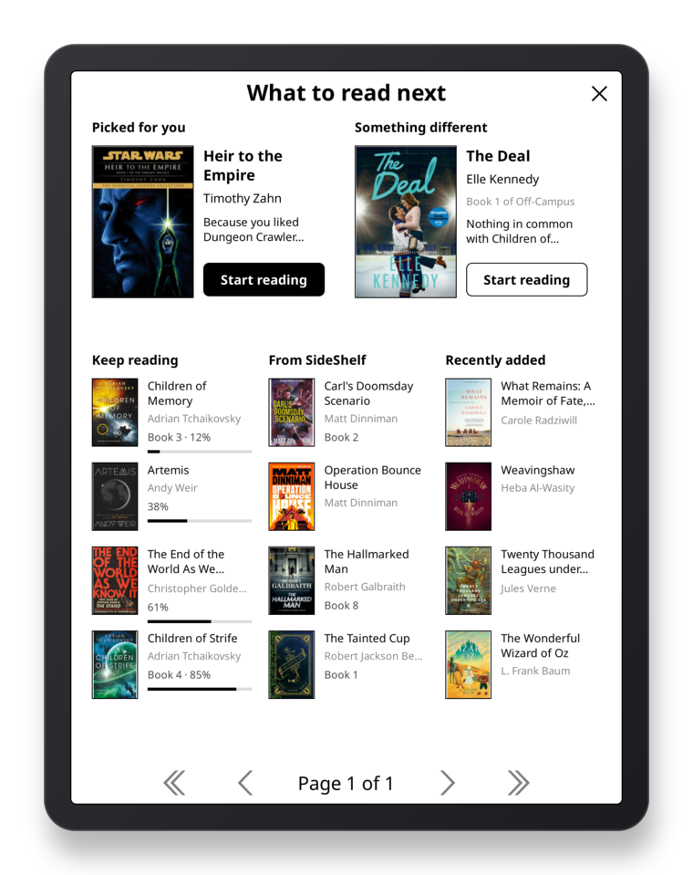
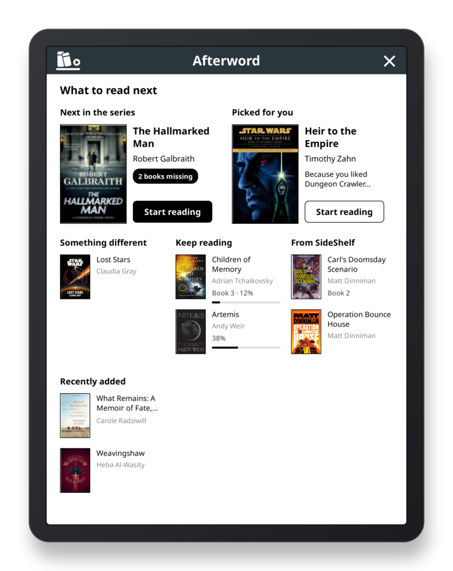
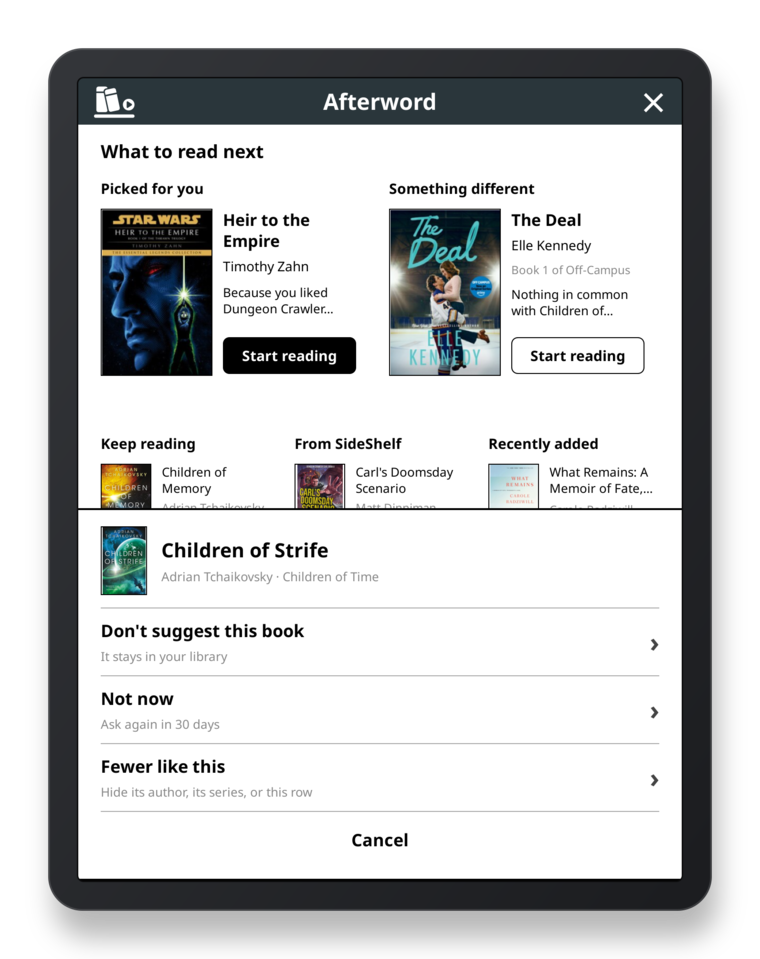
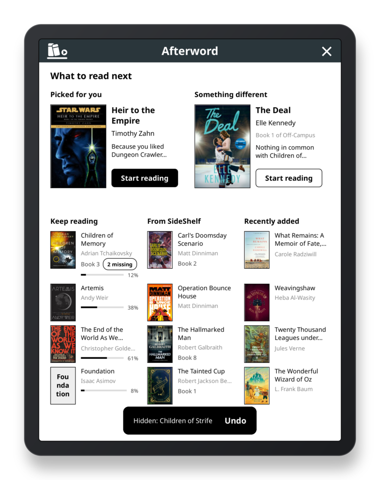
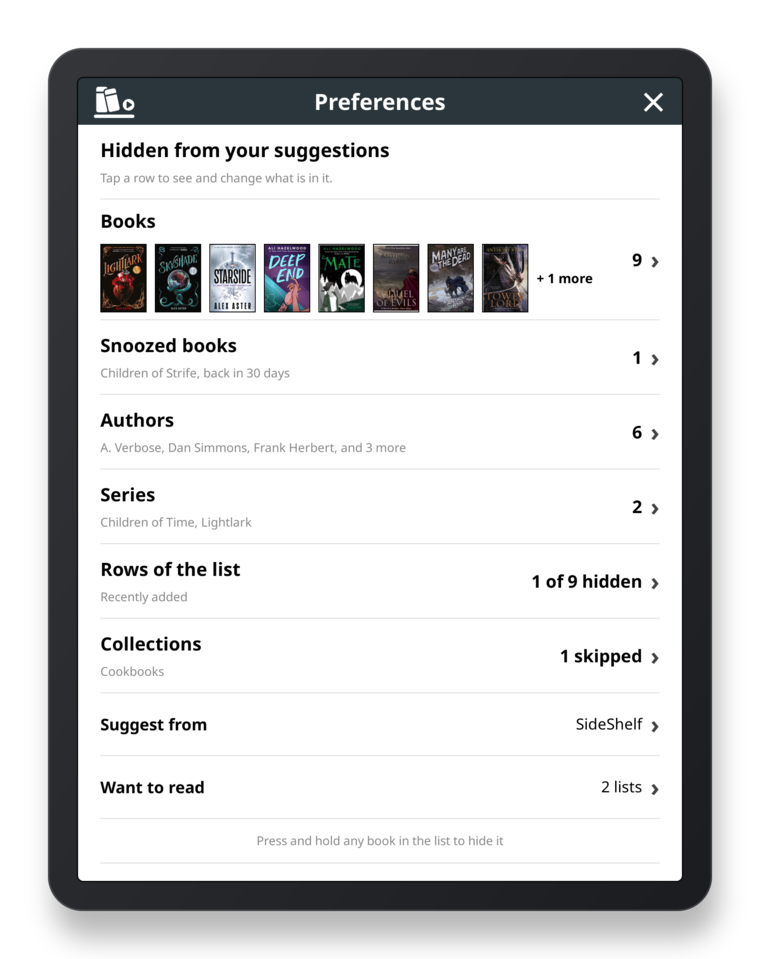
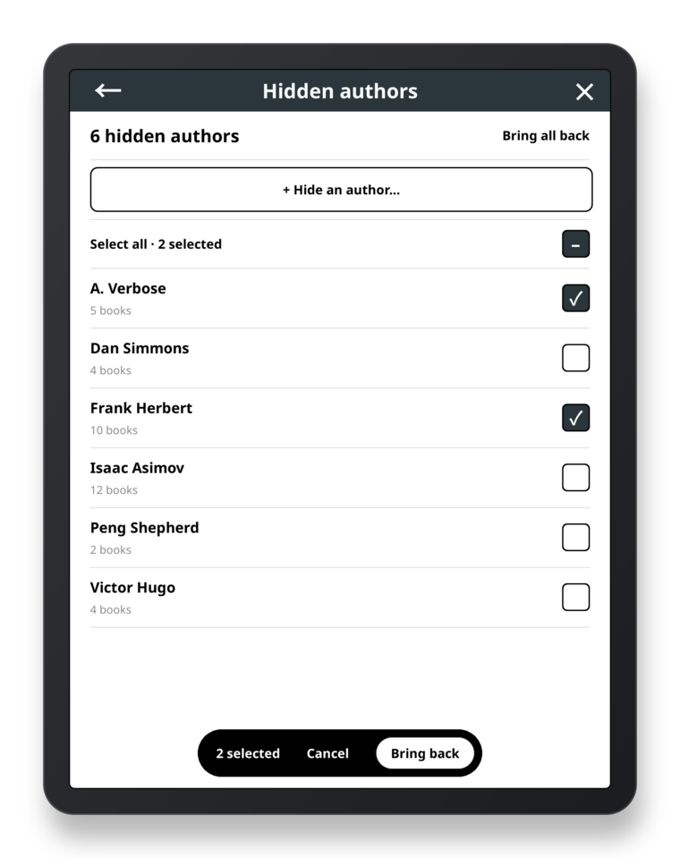
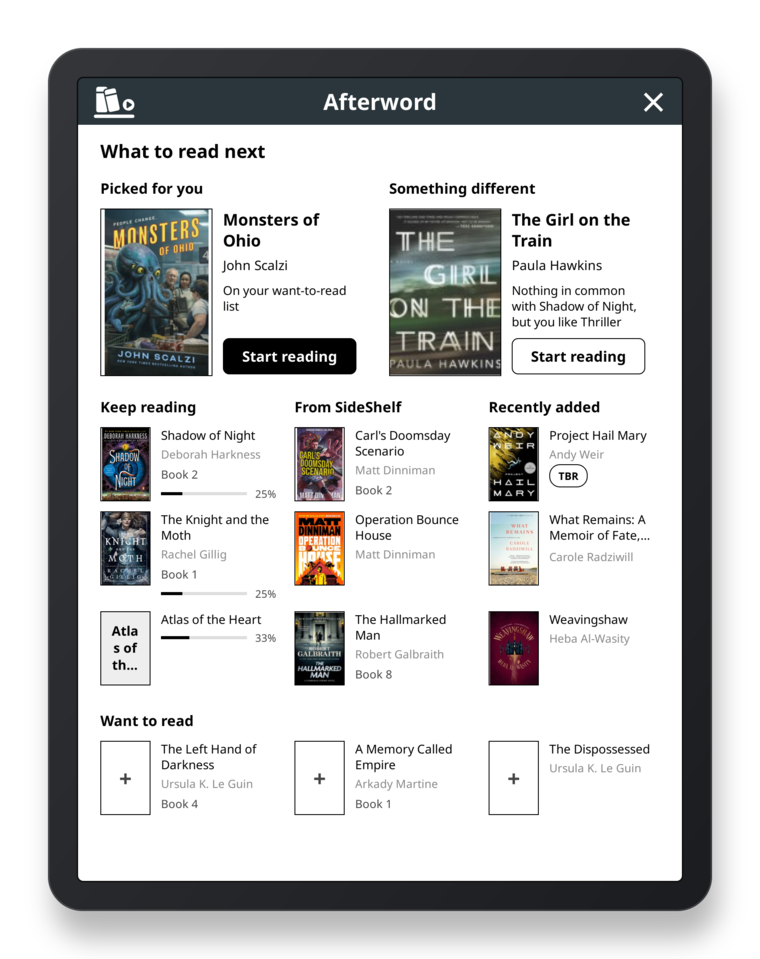
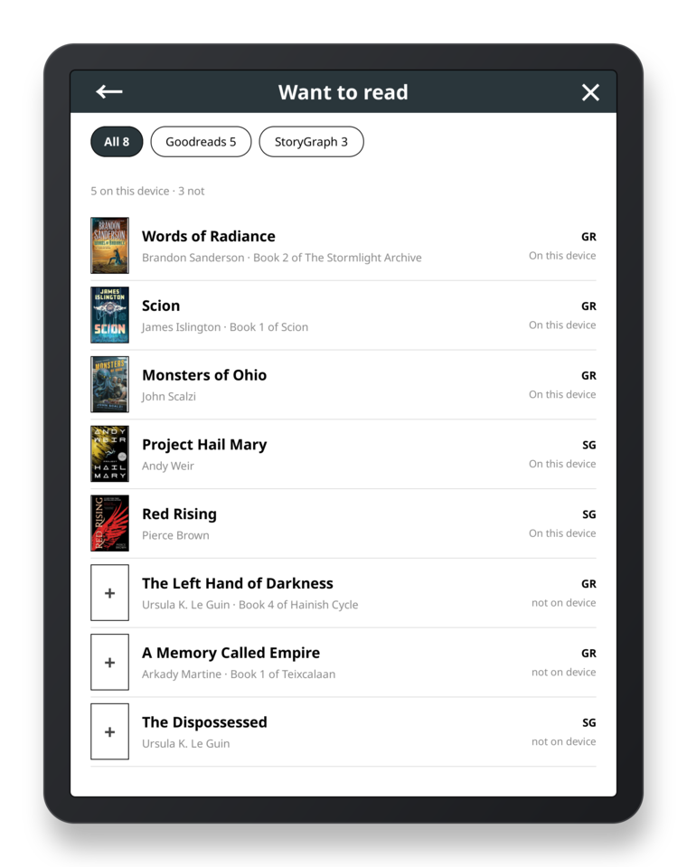
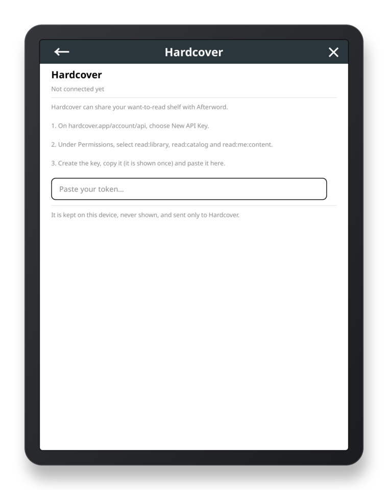

  <picture>
    <source media="(prefers-color-scheme: dark)" srcset="assets/logo-dark.svg">
    
  </picture>

<h1 align="center">Afterword</h1>

  What comes after the last page. 
  A plugin for <a href="https://github.com/koreader/koreader">KOReader</a>.

When you reach the end of a book, Afterword shows one screen over the last page: how the book went, a place to rate it, and what to read next. **Pick next…** opens a list of what to read, which is also there any time from **Tools › Afterword › What to read next**.

  
  

It is one screen, in portrait or landscape; the picks' covers take whatever height the lists leave:

  

## What it shows

- **The book:** cover, title, author, and its place in a series (**Cormoran Strike #3**).
- **How it went:** how long you took from your first page to your last, the time you spent reading, and pages a day. A figure KOReader has no record of is left out. This comes from KOReader's own reading statistics, so it needs the Statistics plugin, which is on by default.
- **Your rating:** five stars. Tap one to rate; tap the first star again to clear. It is saved where KOReader's own book status page keeps it.
- **Mark as finished:** a box that starts the way you already set up KOReader. It is selected when KOReader's "mark a book finished at its end" setting is on, or when the book is already finished. Leaving the screen marks the book finished if it is selected, and puts a finished book back to reading if you clear it.
- **Next:** the first book after this one in its series that you own and have not finished. Hidden when there is none.
- **Pick next…:** a list of what to read, in groups, never a book you have finished, and each book only once. The groups, in the order shown:
  1. **Next in the series**, **Picked for you** and **Something different** are single picks. The first two that apply sit side by side at the top, each with a cover, its title, author and series, a line saying why it was picked, and a **Start reading** button.
  2. **Keep reading:** books you started and did not finish, with how far through each you are. It includes any half-read book in your library, not only recent ones.
  3. **More by** the author, **From** a collection you choose (see below), and **Recently added** are lists too.

  The lists are columns of small-cover rows, three across, each with its title, author and a quiet grey line: which book of its series it is ("Book 3"), and how far through it you are. A book with no cover in KOReader's cache gets a plain grey card with its title. **Tap a cover or a Start reading button to open the book.** **Press and hold a book for a sheet of choices:** don't suggest it, "not now" (it comes back in 30 days), or "fewer like this" (its author, its series, or the row it sits in). The list is rebuilt at once, and a bar offers Undo for a few seconds.

  Picked for you is one unread book that fits your taste, with the books you liked behind it; Something different is for when you want the opposite of the book you are on (or, from the file browser, the one you read last): one unread book that shares none of its tags and none you have rated down, and fits the tags you do like.

**Nothing is suggested out of order in a series.** A book in a series is only offered as something new when every lower-numbered book of that series you own is finished, so book 3 never appears while book 2 is unread, half read or on hold (a gap in what you own is skipped). It applies to every group, your collection included, except "Keep reading", which is about books you already started. A series book with no number cannot be placed, so it is not offered.

**A badge says when a book skips ahead.** If you own book 5 but not book 4, the book's card carries a small black badge: "Book 4 missing", or "3 books missing" when several before it are not in your library. It shows on the picks and, shorter ("2 missing"), beside "Book 8" in the lists, so you know before you choose. On the lists it is a quieter, outlined pill, and a book you are reading shows its percentage at the end of its progress bar.

  

**Picked for you** is worked out on the device from what KOReader already knows. A book you rated 4 or 5 counts for its genre tags, a 3 a little, a 1 or 2 against them; a book you finished without rating counts a little for them, and one you put on hold a little against. An unread book is scored by how many of its tags you have liked, with rare tags counting for more than ones nearly everything has, and books in a language you do not read are left out. It needs at least two books you liked before it will guess, and books with no tags are never offered. Nothing is sent anywhere.

**A new device still gets picks.** With no history or ratings yet, Picked for you is the first book of a series you own (or your newest book) and says it is a good place to start, and Something different is a book with a tag few others in your library have (or by an author you have few books from). Both give way as soon as there is a taste to go on. If nothing is new, the books you put on hold appear under **On hold**, longest wait first, each with how long ago you put it down.

The screenshots are from the KOReader desktop emulator, with reading numbers made up for the picture.

## Hiding things

Not everything in your library is something you want suggested. **Press and hold a book** for a sheet: don't suggest it, "not now" (it comes back in 30 days), or "fewer like this" (its author, its series, or the row it sits in). The list rebuilds at once, and a bar offers Undo.

  
  

Everything you have hidden is in **Preferences**, from Tools › Afterword or by tapping the mark in the header: a row per kind with a count, each opening its own screen. Select any number and bring them back from the bar that floats at the bottom, which asks first. If everything in your library ends up hidden, the list says so and has an **Open Preferences** button, so there is always a way back.

  
  

## Books you mean to read

Afterword can favour the books on your want-to-read shelf. In **Preferences › Want to read**, **Import a list from a file…** reads a CSV exported from Goodreads (My Books › Import and export › Export Library) or from StoryGraph's export page, or any CSV with a Title and an Author column, and keeps only the books on its to-read shelf. Each service keeps its own list, and importing one again replaces only that one. It asks first, saying how many of the books are in your library. Books are matched to your library by title and the author's surname, ignoring a leading "The", a subtitle and the series Goodreads puts in brackets. Nothing is sent anywhere: Afterword only reads the file.

- **Books you have** are tagged **TBR**, and the pick for you is one of them (with the line "On your want-to-read list"). They also come first in Recently added. Switch off **Rank books on my lists higher** to keep the tag and nothing else.
- **Books you don't have** appear only if you switch on **Show books I don't own**: a **Want to read** row of up to three books side by side, each with an empty frame where a cover would be. There is nothing to open, so tapping one offers a sheet that says so, and a way to switch the row off again.
- **Hardcover.** **Connect a service…** opens the Hardcover screen; nothing about Hardcover shows anywhere else until you have connected it. On hardcover.app/account/api choose **New API Key** and, under Permissions, select **`read:library`** (your want-to-read entries, public or private), **`read:catalog`** and **`read:me:content`** (just your public profile: leave out the email and roles scopes ticked along with `read:me`); nothing else is needed to sync. Create the key, copy it (Hardcover shows it once) and paste it into the field there: the dialog hides it as it is entered (with a Show password box), and Afterword tries it at once. A token Hardcover refuses is not kept. Then **Sync now** fetches your want-to-read shelf, when you ask and never in the background, and keeps it as its own list beside the others, with its own tab. The token is kept on the device, never shown, and sent only to Hardcover; **Change token…** replaces it, and **Disconnect** forgets the list and deletes the token. If a sync fails, the last good list stays.
- **Browsing a list.** Tap a list in Want to read to browse it, with a tab for **All** (every list merged, books you have first) and one for each list. A book you have opens when you tap it. A list's tab has **Import again** and **Remove this list**, which asks first and forgets the list here only.

  
  
  

## Settings

**Tools › Afterword**, in a book or in the file browser:

- **Show at the end of a book.** On by default. Off, KOReader's own end-of-book popup is used as before.
- **What to read next.** The same list, whenever you want it, from a book you have open or from the file browser: for when you started a book and are not into it. From a book you have open it leaves out the next-in-series and more-by groups, which are about the book you are leaving; from the file browser they follow on from the book you read last. It does not touch the open book: it stays "reading" and turns up under "Keep reading". It is also in KOReader's action list (**Afterword: what to read next**), so a gesture, profile or hotkey can start it.
- **Suggest from a collection….** Pick any KOReader collection, and Pick next also offers its first books, in its own order. A Bookshelf shelf is a collection, so it works with one. Choose **None** to turn it off.
- **Preferences.** One screen for everything you told Afterword not to suggest, from Tools › Afterword or from the menu behind the mark in the list's header (the same menu has Check for updates and Close). It has a row per kind with a count: hidden books (with their covers), snoozed books, authors, series, rows of the list and collections. A kind opens its own screen: select any number with the checkboxes (or Select all) and bring them back from the bar that floats at the bottom, which asks before it does. Authors and series have **+ Hide an author…** to pick from your whole library without finding one of their books first. Rows have a switch each, and each collection is Normal, Suggest from or Skip. **Want to read** (see above) is here too, for importing and browsing the lists you keep elsewhere. It is built to hold a long list: a filter box appears when there are many, and a screen pages only when it overflows.
- **Check for updates.** Asks GitHub whether a newer Afterword has been released, only when you tap it. If there is one it shows the release notes and offers to download it, check it against GitHub's checksum, install it and restart KOReader. If anything goes wrong nothing is changed, and the old version is kept as `afterword.koplugin.old`. A copy that is a link to a source checkout is not updated from here.

## Install

1. Copy the `afterword.koplugin` folder into KOReader's `plugins` folder and restart KOReader.
2. Open **Tools › Afterword**.

## Development

`tests/run.sh` runs the unit tests under plain `luajit`. The logic (`series.lua`, `stats.lua`, `finish.lua`, `suggest.lua`, and the update check's `version.lua`, `updater.lua` and `installer.lua`) has no KOReader code in it, so that is all it needs. The three update files are ShelfSpace's, synced by `tools/sync-shared.sh` from a pinned commit; do not edit them here. The screen and the wiring (`main.lua`, `screen.lua`, `store.lua`) are checked in KOReader itself.

KOReader's own handler for the end of a book runs before any plugin and does not stop the event, so Afterword wraps that handler for the book that is open: its screen when it is on, KOReader's own, untouched, when it is off.

The logo is drawn by `tools/make-logo.py`, which needs KOReader's `NotoSans-Bold.ttf`. It writes `assets/logo-light.svg` and `assets/logo-dark.svg`.
