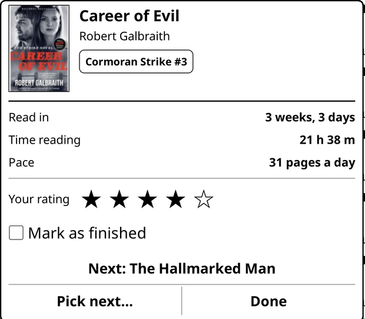

  <picture>
    <source media="(prefers-color-scheme: dark)" srcset="assets/logo-dark.svg">
    
  </picture>

<h1 align="center">Afterword</h1>

  What comes after the last page. 
  A plugin for <a href="https://github.com/koreader/koreader">KOReader</a>.

When you reach the end of a book, Afterword shows one screen: how the book went, a place to rate it, and what to read next.

  
  

## What it shows

- **The book:** cover, title, author, and its place in a series (**Cormoran Strike #3**).
- **How it went:** how long you took from your first page to your last, the time you spent reading, and pages a day. A figure KOReader has no record of is left out. This comes from KOReader's own reading statistics, so it needs the Statistics plugin, which is on by default.
- **Your rating:** five stars. Tap one to rate; tap the first star again to clear. It is saved where KOReader's own book status page keeps it.
- **Mark as finished:** a box that starts the way you already set up KOReader. It is selected when KOReader's "mark a book finished at its end" setting is on, or when the book is already finished. Leaving the screen marks the book finished if it is selected, and puts a finished book back to reading if you clear it.
- **Next:** the first book after this one in its series that you own and have not finished. Hidden when there is none.
- **Pick next…:** a list of what to read, in groups, up to three each, never a book you have finished, and each book only once:
  1. **Next in the series**
  2. **More by** the author: their other books you have not started (not this book's series, which is the group above)
  3. **From** a collection you choose (see below)
  4. **Recently added:** the newest books you have not started
  5. **Pick up where you left off:** books you started and did not finish

The screenshots are from the KOReader desktop emulator, with reading numbers made up for the picture.

## Settings

**Tools › Afterword**, in a book or in the file browser:

- **Show at the end of a book.** On by default. Off, KOReader's own end-of-book popup is used as before.
- **Suggest from a collection….** Pick any KOReader collection, and Pick next also offers its first books, in its own order. A Bookshelf shelf is a collection, so it works with one. Choose **None** to turn it off.
- **Check for updates.** Asks GitHub whether a newer Afterword has been released, only when you tap it. If there is one it shows the release notes and offers to download it, check it against GitHub's checksum, install it and restart KOReader. If anything goes wrong nothing is changed, and the old version is kept as `afterword.koplugin.old`. A copy that is a link to a source checkout is not updated from here.
- **Preview now.** Shows the screen for the book you have open, without reaching its end. A preview never changes the book's status.

## Install

1. Copy the `afterword.koplugin` folder into KOReader's `plugins` folder and restart KOReader.
2. Open **Tools › Afterword**.

## Development

`tests/run.sh` runs the unit tests under plain `luajit`. The logic (`series.lua`, `stats.lua`, `finish.lua`, `suggest.lua`, and the update check's `version.lua`, `updater.lua` and `installer.lua`) has no KOReader code in it, so that is all it needs. The three update files are ShelfSpace's, synced by `tools/sync-shared.sh` from a pinned commit; do not edit them here. The screen and the wiring (`main.lua`, `screen.lua`, `store.lua`) are checked in KOReader itself.

KOReader's own handler for the end of a book runs before any plugin and does not stop the event, so Afterword wraps that handler for the book that is open: its screen when it is on, KOReader's own, untouched, when it is off.

The logo is drawn by `tools/make-logo.py`, which needs KOReader's `NotoSans-Bold.ttf`. It writes `assets/logo-light.svg` and `assets/logo-dark.svg`.
