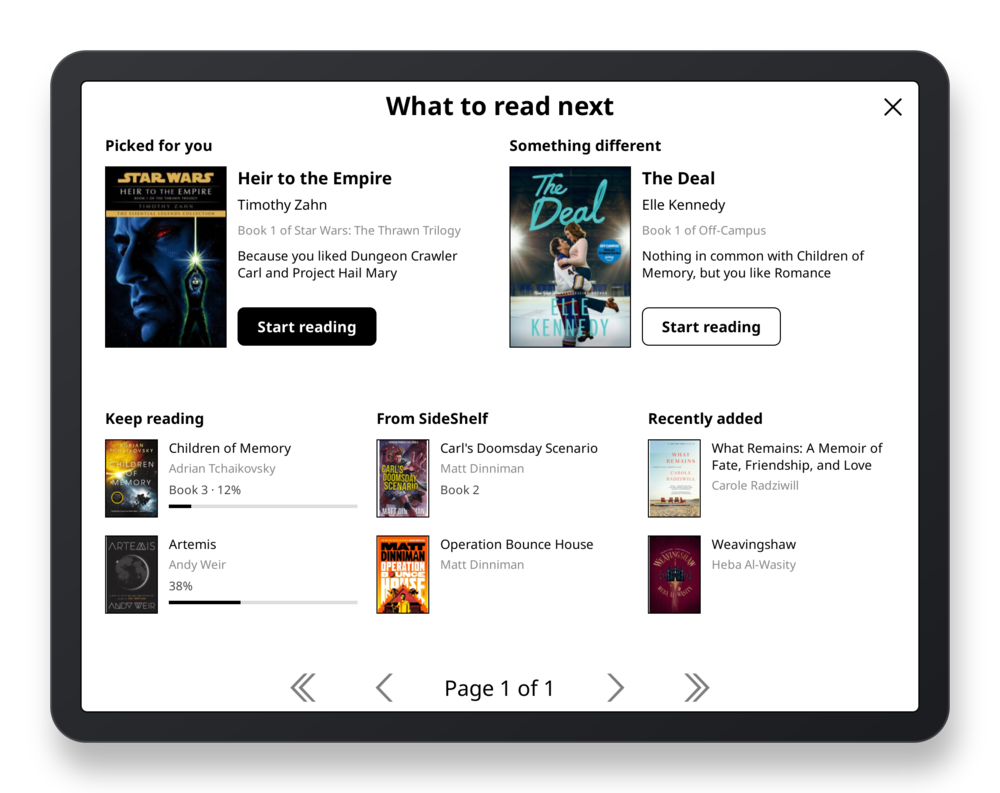

  <picture>
    <source media="(prefers-color-scheme: dark)" srcset="assets/logo-dark.svg">
    
  </picture>

<h1 align="center">Afterword</h1>

  What comes after the last page. 
  A plugin for <a href="https://github.com/koreader/koreader">KOReader</a>.

When you reach the end of a book, Afterword shows one screen over the last page: how the book went, a place to rate it, and what to read next. **Pick next…** opens a list of what to read, which is also there any time from **Tools › Afterword › What to read next**.

  
  

It is one screen, in portrait or landscape; the picks' covers take whatever height the lists leave:

  

## What it shows

- **The book:** cover, title, author, and its place in a series (**Cormoran Strike #3**).
- **How it went:** how long you took from your first page to your last, the time you spent reading, and pages a day. A figure KOReader has no record of is left out. This comes from KOReader's own reading statistics, so it needs the Statistics plugin, which is on by default.
- **Your rating:** five stars. Tap one to rate; tap the first star again to clear. It is saved where KOReader's own book status page keeps it.
- **Mark as finished:** a box that starts the way you already set up KOReader. It is selected when KOReader's "mark a book finished at its end" setting is on, or when the book is already finished. Leaving the screen marks the book finished if it is selected, and puts a finished book back to reading if you clear it.
- **Next:** the first book after this one in its series that you own and have not finished. Hidden when there is none.
- **Pick next…:** a list of what to read, in groups, never a book you have finished, and each book only once. The groups, in the order shown:
  1. **Next in the series**, **Picked for you** and **Something different** are single picks. The first two that apply sit side by side at the top, each with a cover, its title, author and series, a line saying why it was picked, and a **Start reading** button.
  2. **Keep reading:** books you started and did not finish, with how far through each you are. It includes any half-read book in your library, not only recent ones.
  3. **More by** the author, **From** a collection you choose (see below), and **Recently added** are lists too.

  The lists are columns of small-cover rows, three across, each with its title, author and a quiet grey line: which book of its series it is ("Book 3"), and how far through it you are. A book with no cover in KOReader's cache gets a plain grey card with its title. **Tap a cover or a Start reading button to open the book.**

  Picked for you is one unread book that fits your taste, with the books you liked behind it; Something different is for when you want the opposite of the book you are on (or, from the file browser, the one you read last): one unread book that shares none of its tags and none you have rated down, and fits the tags you do like.

**Nothing is suggested out of order in a series.** A book in a series is only offered as something new when every lower-numbered book of that series you own is finished, so book 3 never appears while book 2 is unread, half read or on hold (a gap in what you own is skipped). It applies to every group, your collection included, except "Keep reading", which is about books you already started. A series book with no number cannot be placed, so it is not offered.

**Picked for you** is worked out on the device from what KOReader already knows. A book you rated 4 or 5 counts for its genre tags, a 3 a little, a 1 or 2 against them; a book you finished without rating counts a little for them, and one you put on hold a little against. An unread book is scored by how many of its tags you have liked, with rare tags counting for more than ones nearly everything has, and books in a language you do not read are left out. It needs at least two books you liked before it will guess, and books with no tags are never offered. Nothing is sent anywhere.

The screenshots are from the KOReader desktop emulator, with reading numbers made up for the picture.

## Settings

**Tools › Afterword**, in a book or in the file browser:

- **Show at the end of a book.** On by default. Off, KOReader's own end-of-book popup is used as before.
- **What to read next.** The same list, whenever you want it, from a book you have open or from the file browser: for when you started a book and are not into it. It leaves out the next-in-series and more-by groups, which are about the book you are leaving, and it does not touch that book: it stays "reading" and turns up under "Keep reading". It is also in KOReader's action list (**Afterword: what to read next**), so a gesture, profile or hotkey can start it.
- **Suggest from a collection….** Pick any KOReader collection, and Pick next also offers its first books, in its own order. A Bookshelf shelf is a collection, so it works with one. Choose **None** to turn it off.
- **Check for updates.** Asks GitHub whether a newer Afterword has been released, only when you tap it. If there is one it shows the release notes and offers to download it, check it against GitHub's checksum, install it and restart KOReader. If anything goes wrong nothing is changed, and the old version is kept as `afterword.koplugin.old`. A copy that is a link to a source checkout is not updated from here.

## Install

1. Copy the `afterword.koplugin` folder into KOReader's `plugins` folder and restart KOReader.
2. Open **Tools › Afterword**.

## Development

`tests/run.sh` runs the unit tests under plain `luajit`. The logic (`series.lua`, `stats.lua`, `finish.lua`, `suggest.lua`, and the update check's `version.lua`, `updater.lua` and `installer.lua`) has no KOReader code in it, so that is all it needs. The three update files are ShelfSpace's, synced by `tools/sync-shared.sh` from a pinned commit; do not edit them here. The screen and the wiring (`main.lua`, `screen.lua`, `store.lua`) are checked in KOReader itself.

KOReader's own handler for the end of a book runs before any plugin and does not stop the event, so Afterword wraps that handler for the book that is open: its screen when it is on, KOReader's own, untouched, when it is off.

The logo is drawn by `tools/make-logo.py`, which needs KOReader's `NotoSans-Bold.ttf`. It writes `assets/logo-light.svg` and `assets/logo-dark.svg`.
